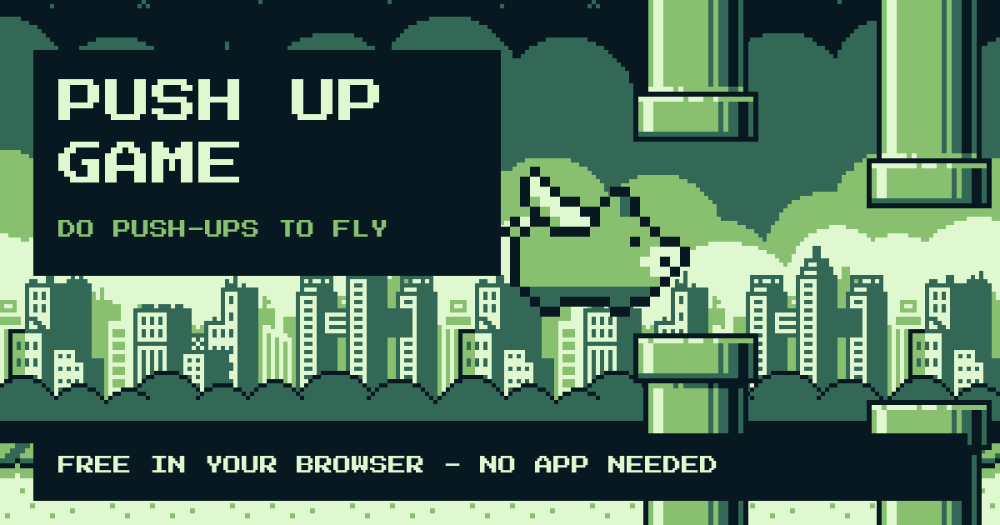

[Push Up Game](https://pushupgame.codeuctivity.cloud/) turns push-ups into an arcade game. Prop your phone up, get into a plank, and every push-up lifts a winged pig through the pipes. Stop pushing and gravity wins.

It runs right in your browser - no install, no account.

<!-- truncate -->

## How to play

1. Open [pushupgame.codeuctivity.cloud](https://pushupgame.codeuctivity.cloud/) on your phone.
2. Lean the phone against something, about a metre away, front camera facing you.
3. Get into a plank so your upper body is in the picture.
4. Push. Every push-up flaps the wings. Miss a beat and the pig sinks.

Score enough and your pig turns into other animals - the last one is a unicorn. The look is a nod to the four-shade screens of old handheld consoles.

## Two players

Challenge a friend: one phone each, same course. Open a room, share the code or the QR code, and race. Your opponent flies next to you as a ghost, the higher score wins.

## Your camera stays yours

The game needs the camera to see your push-ups, so privacy was not an afterthought:

- The camera picture is analysed **on your device** and is never uploaded.
- No account, no sign-up, no ads.
- Your highscore is stored in your browser, not on a server.

## Install it like an app

Push Up Game is a progressive web app. In a Chromium browser you can add it to the home screen, and it then starts full screen like any other app. How that install button works is described in [Install button for websites](/blog/install-button-for-websites/).

## Try it

[pushupgame.codeuctivity.cloud](https://pushupgame.codeuctivity.cloud/) - how far do you get?
